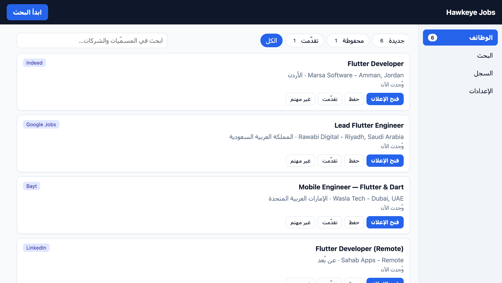
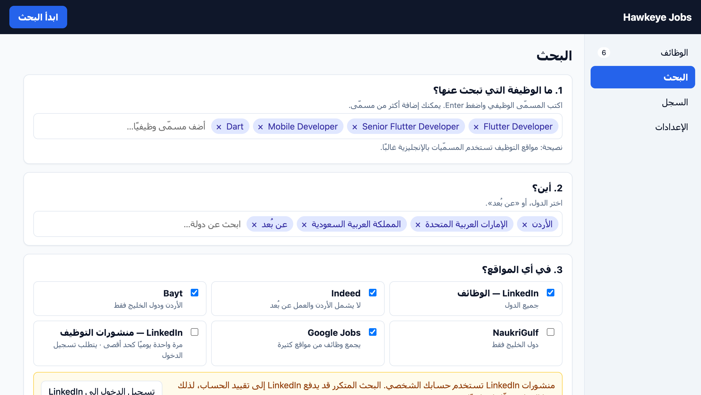
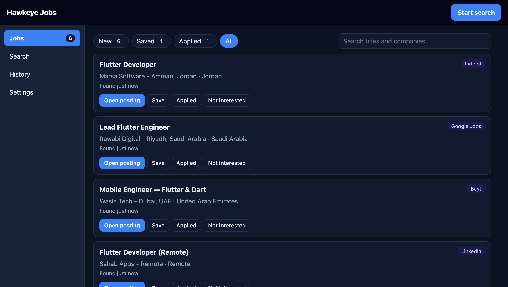

<p align="center">
  
</p>

<h1 align="center">Hawkeye Jobs</h1>

<p align="center">
  A free, open-source job finder for LinkedIn, Indeed, Bayt, NaukriGulf and Google Jobs.<br>
  It runs entirely on your computer: no server, no account. Arabic and English.<br>
  <b>تطبيق مجاني ومفتوح المصدر للبحث عن الوظائف، يعمل كاملًا على جهازك، بالعربية والإنجليزية.</b>
</p>

<p align="center">
  <a href="https://abdallahabusnineh.github.io/hawkeye-jobs/"><b>Download</b></a> ·
  <a href="https://github.com/Abdallahabusnineh/hawkeye-jobs/releases/latest">Latest release</a> ·
  <a href="docs/ARCHITECTURE.md">How it works</a>
</p>

| Jobs (Arabic) | Search |
|---|---|
|  |  |



<sub>Screenshots use sample jobs.</sub>

## Download

| System | File |
|---|---|
| macOS (Apple M1 or newer) | [HawkeyeJobs-macOS-AppleSilicon.dmg](https://github.com/Abdallahabusnineh/hawkeye-jobs/releases/latest/download/HawkeyeJobs-macOS-AppleSilicon.dmg) |
| macOS (Intel) | [HawkeyeJobs-macOS-Intel.dmg](https://github.com/Abdallahabusnineh/hawkeye-jobs/releases/latest/download/HawkeyeJobs-macOS-Intel.dmg) |
| Windows 10 / 11 | [HawkeyeJobs-Windows-Setup.exe](https://github.com/Abdallahabusnineh/hawkeye-jobs/releases/latest/download/HawkeyeJobs-Windows-Setup.exe) (installer) · [.zip](https://github.com/Abdallahabusnineh/hawkeye-jobs/releases/latest/download/HawkeyeJobs-Windows.zip) |
| Linux (x86-64) | [HawkeyeJobs-Linux.AppImage](https://github.com/Abdallahabusnineh/hawkeye-jobs/releases/latest/download/HawkeyeJobs-Linux.AppImage) · [.tar.gz](https://github.com/Abdallahabusnineh/hawkeye-jobs/releases/latest/download/HawkeyeJobs-Linux.tar.gz) |

**Windows, easiest:** open PowerShell and paste `irm https://abdallahabusnineh.github.io/hawkeye-jobs/install.ps1 | iex` — same idea: installs and opens the app, with no warning.

**Mac, easiest:** open Terminal and paste `curl -fsSL https://abdallahabusnineh.github.io/hawkeye-jobs/install.sh | bash` — it downloads the right build, checks its checksum, installs it to Applications and opens it, with no warning.

The app is not signed with a paid certificate, so the first launch shows a warning: on macOS open **System Settings → Privacy & Security → Open Anyway**; on Windows click **More info → Run anyway**. Bayt, NaukriGulf, Google Jobs and LinkedIn posts need [Google Chrome](https://www.google.com/chrome/).

## Features

- **Only new jobs.** Every job it finds is remembered (new / saved / applied / not interested), so you never see the same posting twice.
- **Searches for you.** Automatic search every few hours, with a desktop notification when new jobs appear; or start one yourself and watch live progress.
- **Six sources, one list:** LinkedIn jobs, Indeed, Bayt.com, NaukriGulf, Google Jobs and LinkedIn hiring posts. Titles must match your keywords; you choose how recent: the last week, two weeks (default) or month.
- **Every country**, with names in Arabic and English (built in, no network).
- **Polite and safe.** Waits between requests to each site so your connection and LinkedIn account are not flagged; LinkedIn posts run at most once a day.
- **Private.** Nothing leaves your computer except the searches, a daily update check (can be turned off), and pages you open.
- **Terminal mode** too: prompts in the terminal and emails an HTML digest of new jobs.

## Requirements (run from source)

- Python 3.12 (python-jobspy pins numpy 1.26.3, which has no wheels for newer Pythons)
- Google Chrome (required for Bayt, NaukriGulf, Google Jobs, LinkedIn posts)
- A Gmail account with an [App Password](https://myaccount.google.com/apppasswords) if you want email

## Setup

```bash
git clone https://github.com/Abdallahabusnineh/hawkeye-jobs.git
cd hawkeye-jobs
python3 -m venv venv
venv/bin/python3 -m pip install -r requirements.txt
cp .env.example .env
```

Edit `.env`:

```
GMAIL_USER=you@gmail.com
GMAIL_PASS=your-16-char-app-password
RECIPIENT_EMAIL=you@gmail.com
```

Create the App Password at [myaccount.google.com/apppasswords](https://myaccount.google.com/apppasswords) (2-Step Verification must be on).

## Run

```bash
bash run.sh
```

Or:

```bash
source venv/bin/activate
python src/main.py
```

You will be asked for:

1. Search keywords (type them, comma-separated), e.g. `Flutter Developer, Mobile Developer`
2. Countries — type to filter, space to select, enter, then Yes/No to confirm those countries
3. Websites — space to select, `a` all, `d` remove all, enter, then Yes/No to confirm those sites
4. Next run: Yes/No to reuse saved settings (↑↓ and enter)

Bayt.com and NaukriGulf only cover Jordan/Gulf. Other countries still search LinkedIn, Indeed, and Google Jobs.

## Desktop app

Download it from the [releases page](https://github.com/Abdallahabusnineh/hawkeye-jobs/releases/latest), or run it from source:

    venv/bin/python3 src/app.py

The window has four pages — **Jobs** (with live progress while a search runs), **Search**, **History** and **Settings** — and a short first-run wizard. Arabic (right-to-left) and English. Everything runs on your computer: the window talks to a small server on 127.0.0.1 that only this app can use.

For UI development, serve without a window on a fixed port and open the printed URL in a browser:

    HAWKEYE_DATA_DIR=/tmp/hawkeye-dev venv/bin/python3 src/app.py --no-window --port 8765

## Building the app

```bash
venv/bin/python3 -m pip install -r requirements-dev.txt
venv/bin/python3 -m PyInstaller packaging/hawkeye.spec --noconfirm   # → dist/
venv/bin/python3 packaging/smoke_test.py                             # self-test + start/serve check
```

Releases are built by GitHub Actions (`.github/workflows/release.yml`) on macOS (Apple Silicon and Intel), Windows and Linux. To publish one, set `__version__` in `src/version.py`, then push a matching tag:

```bash
git tag v1.0.0
git push origin v1.0.0
```

The download page in `site/` is published to GitHub Pages by `.github/workflows/pages.yml`.

## Where your data lives

Everything hawkeye-jobs saves is kept in one folder on your computer:

| OS | Folder |
|---|---|
| macOS | `~/Library/Application Support/hawkeye-jobs` |
| Windows | `C:\Users\<you>\AppData\Local\hawkeye-jobs` |
| Linux | `~/.local/share/hawkeye-jobs` |

It contains `hawkeye.db` (jobs and searches), `config.json` (your search settings), `hawkeye.log` (attach this when reporting a problem), and `linkedin-profile/` (the Chrome profile used for LinkedIn posts).

Set `HAWKEYE_DATA_DIR` to use a different folder. If you used hawkeye-jobs before this change, your old `config.json` and `seen_jobs.json` are imported automatically the first time you run it. The old files are left in place.

**Reset** (forget all jobs and get notified again): delete `hawkeye.db*` (all three files: `hawkeye.db`, `hawkeye.db-wal`, `hawkeye.db-shm`) from that folder. If you used an older version, also delete the old `seen_jobs.json` in the project folder, otherwise it is imported again on the next run and those jobs stay hidden.

**LinkedIn posts** need a one-time login. Open Chrome with the profile the tool uses, sign in to LinkedIn, and close it:

    open -a "Google Chrome" --args --user-data-dir="$HOME/Library/Application Support/hawkeye-jobs/linkedin-profile"

If you already have `~/.hawkeye-linkedin-profile` from an older version, it keeps being used.

**Chrome** is found automatically on macOS, Windows, and Linux, and its version is detected for you. Set `HAWKEYE_CHROME_MAJOR` only if detection picks the wrong version.

## Reset

See [Where your data lives](#where-your-data-lives) to forget all jobs.

If an older version installed a macOS LaunchAgent:

```bash
bash uninstall_cron.sh
```

## Project structure

```
hawkeye-jobs/
├── src/
│   ├── main.py            # Prompts, then runs the pipeline
│   ├── settings.py        # Terminal prompts + config.json
│   ├── picker.py          # Arrow/space checkbox menus + searchable country list
│   ├── catalog.py         # Country/source → per-site queries
│   ├── countries.py       # Offline world country list (Babel/CLDR)
│   ├── filters.py         # Title / hiring-post matching
│   ├── scraper.py         # LinkedIn + Indeed (JobSpy)
│   ├── bayt.py            # Bayt.com
│   ├── naukrigulf.py      # NaukriGulf
│   ├── google_jobs.py     # Google Jobs
│   ├── linkedin_posts.py  # LinkedIn hiring posts
│   ├── browser.py         # Chrome discovery + shared driver
│   ├── pipeline.py        # One search run: lanes, events, cancel
│   ├── store.py           # SQLite jobs, statuses, runs
│   ├── paths.py           # Data directory and file locations
│   ├── logs.py            # Rotating log file
│   ├── utils.py           # URL cleaning, date parsing
│   ├── app.py             # Desktop launcher (local server + window)
│   ├── runner.py          # One search at a time, live events, auto-search
│   ├── reporting.py       # Report new jobs, then mark them
│   ├── run_lock.py        # Cross-process "one search at a time" lock
│   ├── notify.py          # Desktop notifications
│   ├── version.py         # App version
│   ├── web/               # Local API (FastAPI) and UI
│   └── email_sender.py    # HTML email + Gmail SMTP
├── packaging/             # PyInstaller spec, launcher, icon, smoke test, release notes
├── site/                  # Download page (GitHub Pages)
├── .github/workflows/     # Tests, release builds, download page
├── docs/ARCHITECTURE.md   # Technical reference
├── config.example.json    # Sample search settings
├── .env.example           # Credential template
└── run.sh                 # Loads .env and runs the pipeline
```

## Troubleshooting

| Problem                       | What to try                                                |
| ----------------------------- | ---------------------------------------------------------- |
| No email                      | Jobs still print in the terminal. Fill in `.env`           |
| 0 jobs from Bayt / NaukriGulf | Chrome must be installed; those sites are Gulf/Jordan only |
| Chrome version error          | Set `HAWKEYE_CHROME_MAJOR` to your Chrome major version    |
| Gmail auth error              | Generate a new App Password                                |
| LinkedIn posts empty          | Log in once using the LinkedIn Chrome profile (see above)  |

## License

MIT
